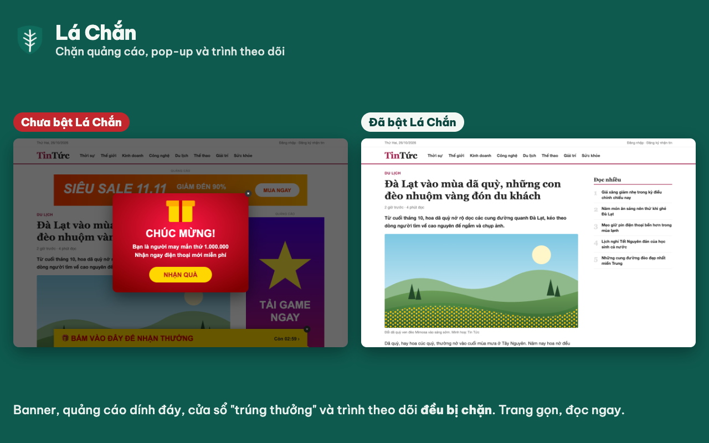

<p align="center">
  
</p>

<h1 align="center">Lá Chắn</h1>

<p align="center">
  Tiện ích Chrome chặn quảng cáo, pop-up và trình theo dõi.<br>
  Có xử lý riêng cho web tiếng Việt và YouTube.
</p>

<p align="center">
  <a href="LICENSE"></a>
  
  
  <a href="https://ducdat147.github.io/la-chan/"></a>
</p>

<p align="center">
  <a href="https://ducdat147.github.io/la-chan/">Website</a> ·
  <a href="#cài-đặt">Cài đặt</a> ·
  <a href="#phát-triển">Phát triển</a> ·
  <a href="PRIVACY.md">Quyền riêng tư</a> ·
  <a href="https://github.com/ducdat147/la-chan/issues">Báo lỗi</a>
</p>



## Mục lục

- [Tính năng](#tính-năng)
- [Cài đặt](#cài-đặt)
- [Sử dụng](#sử-dụng)
- [Phát triển](#phát-triển)
- [Cấu trúc dự án](#cấu-trúc-dự-án)
- [Giới hạn](#giới-hạn)
- [Quyền riêng tư](#quyền-riêng-tư)
- [Đóng góp](#đóng-góp)
- [Giấy phép](#giấy-phép)

## Tính năng

- Chặn ở tầng mạng bằng EasyList, EasyPrivacy và ABPVN, biên dịch thành luật `declarativeNetRequest`. Hơn 110.000 bộ lọc gốc gộp lại còn khoảng 13.000 luật, dưới mức 30.000 luật Chrome luôn đảm bảo.
- Ẩn khung quảng cáo còn sót bằng CSS chèn với độ ưu tiên người dùng, trang web không ghi đè được. Hỗ trợ `:has-text()`, `:upward()`, `:remove()`, `:style()`.
- Tự đóng pop-up và pop-under mở tới tên miền quảng cáo.
- Chặn tab quảng cáo bật ra khi bấm vào trang, kể cả với tên miền chưa có trong danh sách. Lớp phủ vô hình và mã bắt click toàn trang đều vô hiệu, kiểu tab-under cũng vậy.
- Chạy scriptlet kiểu uBlock Origin trên những trang có pop-up hoặc đòi tắt trình chặn, phần lớn lấy từ ABPVN.
- Trên YouTube, dữ liệu quảng cáo bị xoá khỏi phản hồi trình phát. Quảng cáo còn lọt được bỏ qua hoặc tua tới cuối, hộp thoại cấm trình chặn bị gỡ, video tự dừng sau quảng cáo được phát tiếp.
- Có công cụ chọn phần tử để ẩn những gì danh sách bỏ sót.
- Tạm dừng theo trang, bật tắt từng danh sách, tự viết bộ lọc theo cú pháp Adblock Plus và uBlock Origin.
- Không gửi dữ liệu duyệt web đi đâu. Phông chữ cũng đóng gói sẵn.

## Cài đặt

Tiện ích chưa có trên Chrome Web Store. Cài dạng giải nén như sau:

1. Tải [mã nguồn dạng zip](https://github.com/ducdat147/la-chan/archive/refs/heads/master.zip) và giải nén, giữ nguyên cấu trúc thư mục.
2. Mở `chrome://extensions`, bật **Chế độ dành cho nhà phát triển** ở góc trên bên phải.
3. Bấm **Tải tiện ích đã giải nén** và chọn thư mục `extension/` (nơi có `manifest.json`).
4. Bấm biểu tượng mảnh ghép trên thanh công cụ rồi ghim **Lá Chắn**.

Cần Chrome 120 trở lên. Edge, Brave, Cốc Cốc và các trình duyệt nhân Chromium khác cài tương tự.

## Sử dụng

Bấm biểu tượng Lá Chắn để xem số yêu cầu đã chặn trên trang (con dấu đỏ). Cũng từ đây bạn tạm dừng chặn trên trang hoặc mở công cụ chọn phần tử.

Gặp quảng cáo lọt thì chọn *Chọn phần tử để ẩn*, hoặc chuột phải rồi chọn *Chặn phần tử này…*. Trỏ vào quảng cáo, bấm, sau đó chọn *Ẩn vĩnh viễn*. Quy tắc được lưu trong *Bộ lọc của tôi*.

Trang bị lỗi thì chọn *Tạm dừng trên trang này* và tải lại trang.

Trang tuỳ chọn mở bằng cách chuột phải vào biểu tượng rồi chọn *Tuỳ chọn*. Ở đó có danh sách lọc, các trang đang tạm dừng, bộ lọc tự viết, cách xử lý pop-up, menu chuột phải và con số trên biểu tượng.

### Bộ lọc tự viết

```
||quangcao.example.vn^              chặn mọi yêu cầu tới tên miền này
example.com##.banner-top            ẩn phần tử trên example.com
##.sponsored-box                    ẩn trên mọi trang
example.com##.tin:has-text(Tài trợ) ẩn khối tin có chữ "Tài trợ"
||trang-quang-cao.vn^$popup         tự đóng pop-up mở tới địa chỉ này
@@||example.com/player.js           cho phép một địa chỉ bị chặn nhầm
```

## Phát triển

Cần Node.js và [pnpm](https://pnpm.io/). Kiểm thử end-to-end cần thêm Python.

```bash
pnpm install
pnpm build           # tải và biên dịch lại bộ lọc
pnpm build:offline   # biên dịch từ bản đã tải trong tools/.cache/
pnpm test            # kiểm thử bộ chuyển đổi bộ lọc
pnpm test:e2e        # 74 kiểm tra trong Chromium thật
```

### Cập nhật bộ lọc

Danh sách lọc được đóng gói sẵn, nên vài tuần nên chạy `pnpm build` một lần. Lệnh này tải EasyList, EasyPrivacy, ABPVN và EasyList Cookie (có địa chỉ dự phòng trên GitHub). Nó biên dịch, kiểm tra từng luật theo đúng điều kiện của Chrome rồi in thống kê. Xong thì vào `chrome://extensions` và bấm tải lại thẻ Lá Chắn.

Nguồn danh sách khai báo trong `tools/lists.mjs`. Thêm một mục vào đó là có thêm danh sách.

### Kiểm thử end-to-end

Chuẩn bị bằng `pip install playwright` và `playwright install chromium`. Bộ kiểm thử dựng một máy chủ cục bộ trả lời cho mọi tên miền, nhờ đó kiểm được việc chặn thật: yêu cầu bị chặn không bao giờ tới máy chủ. Các kịch bản phủ ẩn phần tử, đóng pop-up, lớp phủ quảng cáo, tab-under, tạm dừng theo trang, công cụ chọn, bộ lọc tự viết, scriptlet trên trang Việt và YouTube. Ảnh chụp giao diện nằm trong `tests/e2e/out/`.

Chrome bản thường từ 137 trở đi bỏ qua cờ `--load-extension`. Hãy đặt `CHROME_PATH` trỏ tới Chromium hoặc Chrome for Testing.

### Website tài liệu

Trang tài liệu là HTML tĩnh trong `docs/`. Mỗi lần push lên `master` có thay đổi trong `docs/`, workflow `.github/workflows/pages.yml` sẽ deploy lên GitHub Pages. Lần đầu cần vào **Settings → Pages** và chọn nguồn **GitHub Actions**.

## Cấu trúc dự án

| Đường dẫn | Vai trò |
| --- | --- |
| `extension/manifest.json` | Khai báo tiện ích Manifest V3. |
| `extension/rules/*.json` | Bộ luật tĩnh, mỗi danh sách một bộ. Bộ lọc chỉ có tên miền (`\|\|ads.com^`) được gộp thành một luật `requestDomains`. |
| `extension/background.js` | Service worker quản lý bộ luật, luật động, chèn CSS, đóng pop-up, menu chuột phải và biểu tượng. |
| `extension/content/cosmetic.js` | Chạy ở mọi khung trang, gom class và id để áp bộ lọc ẩn, chạy bộ lọc nâng cao. |
| `extension/content/click-guard.js` | Chặn tab quảng cáo mở từ lớp phủ vô hình, mã bắt click và tab-under. |
| `extension/content/youtube.js` | Bỏ qua quảng cáo YouTube còn lọt, phát tiếp video bị dừng. |
| `extension/content/picker.js` | Công cụ chọn phần tử. |
| `extension/scriptlets/*.js` | Scriptlet chạy trong ngữ cảnh trang, chỉ đăng ký cho tên miền có trong danh sách. |
| `extension/lib/` | Bộ chuyển đổi cú pháp bộ lọc, dùng chung cho lệnh build và bộ lọc tự viết. |
| `filters-src/youtube.txt` | Danh sách YouTube riêng của Lá Chắn. |
| `tools/` | Lệnh build bộ lọc, mã nguồn scriptlet, kiểm thử đơn vị. |
| `tests/e2e/` | Kiểm thử trong trình duyệt thật. |
| `docs/` | Website tài liệu trên GitHub Pages. |

Vài quyết định thiết kế:

- Chỉ một luật tĩnh sai là Chrome từ chối nạp cả tiện ích. Lệnh build vì thế kiểm từng luật, kiểm selector bằng trình phân tích CSS và chuyển regex sang luật động, nơi chúng được kiểm bằng `isRegexSupported()` lúc chạy.
- EasyList có khoảng 13.000 bộ lọc ẩn chung chỉ gồm một class hoặc id. Chèn hết vào mọi trang thì quá nặng. `cosmetic.js` gom những class và id thực sự có trên trang theo từng đợt nhỏ, service worker chỉ chèn phần khớp.
- Ngoại lệ `@@` mang số luật nhỏ hơn luật chặn, nhờ vậy cửa sổ tiện ích đếm đúng số yêu cầu bị chặn.

## Giới hạn

- Không trình chặn nào bắt được mọi quảng cáo. Gặp cái lọt thì dùng công cụ chọn phần tử.
- YouTube đổi cách phát quảng cáo liên tục, có cả quảng cáo chèn từ máy chủ. Khi đó có thể phải sửa `filters-src/youtube.txt` hoặc `extension/content/youtube.js`.
- Bài tài trợ trên Facebook và TikTok nằm lẫn trong luồng nội dung, mã lại bị làm rối. Các danh sách đi kèm gần như không xử lý được.
- Manifest V3 giới hạn regex ở 2 KB khi biên dịch và không hỗ trợ `$csp`, `$removeparam`. Scriptlet `trusted-*` và vài tài nguyên chuyển hướng của uBlock Origin cũng không có. Lệnh build in rõ bộ lọc nào bị bỏ và lý do.
- Bộ lọc chỉ mới khi build lại.
- Chrome tự tạo `extension/_metadata/` khi tải dạng giải nén. Thư mục này là dữ liệu tạm, xoá được.

## Quyền riêng tư

Lá Chắn không thu thập, không gửi đi và không chia sẻ dữ liệu duyệt web. Mọi xử lý diễn ra trong trình duyệt, cài đặt nằm trong bộ nhớ cục bộ của Chrome. Chi tiết xem [PRIVACY.md](PRIVACY.md) hoặc [bản trên website](https://ducdat147.github.io/la-chan/privacy.html).

Tiện ích xin các quyền `declarativeNetRequest`, `declarativeNetRequestFeedback`, `storage`, `scripting`, `contextMenus`, `webNavigation` và quyền truy cập mọi trang (`<all_urls>`). Thiếu quyền truy cập mọi trang thì không chặn quảng cáo được ở bất kỳ đâu.

## Đóng góp

Báo lỗi hoặc gửi trang còn quảng cáo lọt tại [Issues](https://github.com/ducdat147/la-chan/issues). Nhớ kèm địa chỉ trang và ảnh chụp nếu có.

Muốn gửi pull request thì chạy `pnpm test` trước. Nếu thay đổi chạm tới hành vi trong trình duyệt, chạy thêm `pnpm test:e2e`.

## Giấy phép

Mã nguồn Lá Chắn phát hành theo [giấy phép MIT](LICENSE).

Thành phần bên thứ ba giữ giấy phép riêng:

- EasyList, EasyPrivacy, EasyList Cookie theo GPLv3 hoặc CC BY-SA 3.0 ([easylist.to](https://easylist.to/)).
- ABPVN theo GPLv3 ([abpvn.com](https://abpvn.com/)).
- Phông Be Vietnam Pro theo SIL Open Font License (`extension/fonts/OFL.txt`).

Dữ liệu trong `extension/rules`, `extension/filters` và `extension/scriptlets` sinh ra từ các danh sách trên và giữ nguyên giấy phép gốc. Khi phát hành lên Chrome Web Store, cần ghi rõ nguồn và tuân thủ các giấy phép này.
